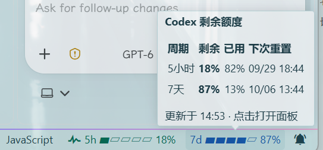

# Codex 额度监控

一个独立的 VS Code 扩展，在侧栏和状态栏显示 Codex 账户的额度窗口、剩余百分比与重置时间。

## 功能

- 优先使用已安装的官方 Codex VS Code 扩展附带的 `codex` 可执行文件；也可在设置中指定自己的可执行文件。
- 通过本机 Codex App Server 的 `account/read` 和 `account/rateLimits/read` 读取数据，不读取 `auth.json`，不保存令牌。
- 展示 Codex 返回的多个额度组；根据窗口时长标注名称，不固定假设短周期和长周期一定存在。
- 状态栏以绿色和蓝色显示两个五格进度条；浅色主题使用更深的颜色。悬停两者均可查看同一详情面板，点击可打开侧栏渐变进度条和账户详情。
- 读取失败时明确显示错误和旧数据状态，不将接口失败显示为 0% 使用量。
- 默认每 10 分钟刷新一次；每次读取后关闭插件启动的 Codex App Server。可在侧栏打开刷新间隔设置，也可手动刷新。

## 界面预览

状态栏分别显示短周期和长周期的**剩余额度**。截图中的 `5h 18%` 表示 5 小时窗口还剩 18%，`7d 87%` 表示 7 天窗口还剩 87%；旁边的五格进度条用于快速查看剩余比例。实际周期以 Codex 返回的数据为准。

鼠标悬停在任一进度条上，会显示各周期的剩余、已用、下次重置时间及最近更新时间。截图中的百分比和时间只是示例，插件会按当前账户数据刷新。



## 使用

此目录是可直接开发的 VS Code 扩展源码，使用原生 JavaScript，没有运行依赖，也不需要编译。

### 安装打包好的 VSIX（推荐）

在本目录运行：

```powershell
code --install-extension .\codex-quota-monitor-0.1.6.vsix
```

然后在 VS Code 命令面板执行 **Developer: Reload Window**，搜索 **Codex 额度：打开面板**。也可以在扩展视图右上角的 `…` 中选择 **Install from VSIX...** 并选中此文件。安装后不需要 F5 或打开开发主机。

### 开发预览

1. 在源码窗口停止已有调试会话；关闭提示“扩展未在 10 秒内启动”的开发窗口。
2. 在本目录的普通 PowerShell 窗口执行以下命令，直接启动开发窗口，绕开调试器：

```powershell
$pluginDir = (Get-Location).Path
code --new-window "--extensionDevelopmentPath=$pluginDir"
```

3. 新窗口左侧打开 **Codex 额度**；也可以在命令面板执行 **Codex 额度：立即刷新**。

也可在源码窗口按 `Ctrl+F5`（**运行 → 运行但不调试**）。`F5` 会附加调试器；如果调试器连接失败，扩展进程会停在第一行并提示“扩展未在 10 秒内启动”。此时不要在提示框中反复点击“重新加载窗口”，应停止调试并使用上述命令。

### 在当前 VS Code 中安装使用

在已打开本目录的 PowerShell 终端执行：

```powershell
$src = (Get-Location).Path
$dst = Join-Path $env:USERPROFILE '.vscode\extensions\sugimoto-local.codex-quota-monitor-0.1.6'
New-Item -ItemType Directory -Path $dst -Force | Out-Null
Copy-Item -LiteralPath "$src\package.json","$src\src","$src\media" -Destination $dst -Recurse -Force
```

然后在当前 VS Code 的命令面板执行 **Developer: Reload Window**。重新打开后搜索 **Codex 额度：打开面板**，或点击侧栏的 **Codex 额度**。这种方式不需要 F5、调试器、npm 安装或 VSIX 打包。修改源码后需要再次复制并重新加载窗口。当前交付未代替用户执行安装或启动。

### 设置

| 设置 | 默认值 | 说明 |
| --- | --- | --- |
| `codexQuota.refreshMinutes` | `10` | 自动刷新间隔，1–60 分钟；已有自定义值继续生效 |
| `codexQuota.codexExecutable` | 空 | Codex 可执行文件完整路径；Windows 指向 `codex.exe` |

## 数据与限制

额度数值由 Codex App Server 提供，扩展不会请求网页私有接口。官方协议中的 `rateLimitsByLimitId`、`rateLimits`、`primary`、`secondary`、`usedPercent`、`resetsAt` 和 `windowDurationMins` 是本扩展的解析依据。API Key 额度与 ChatGPT 订阅额度不同；账户接口拒绝请求时，扩展会显示 401/403 及可操作的提示，但无法绕过服务端授权。

插件仅管理自己启动的 App Server 进程，不结束官方 Codex 扩展或其他程序启动的进程。VS Code 正常关闭时，插件会结束正在读取的进程；异常退出时，系统关闭的标准输入管道会触发 App Server 的连接关闭流程。

参考：[Codex App Server 协议](https://github.com/openai/codex/blob/main/codex-rs/app-server/README.md)、[额度响应结构](https://github.com/openai/codex/blob/main/codex-rs/app-server-protocol/schema/json/v2/GetAccountRateLimitsResponse.json)、[VS Code Webview API](https://code.visualstudio.com/api/extension-guides/webview)。

## 静态检查

`npm run check` 检查 JavaScript 语法；`npm test` 验证额度窗口和多额度组解析。两者都不会启动 Codex 或 VS Code。
